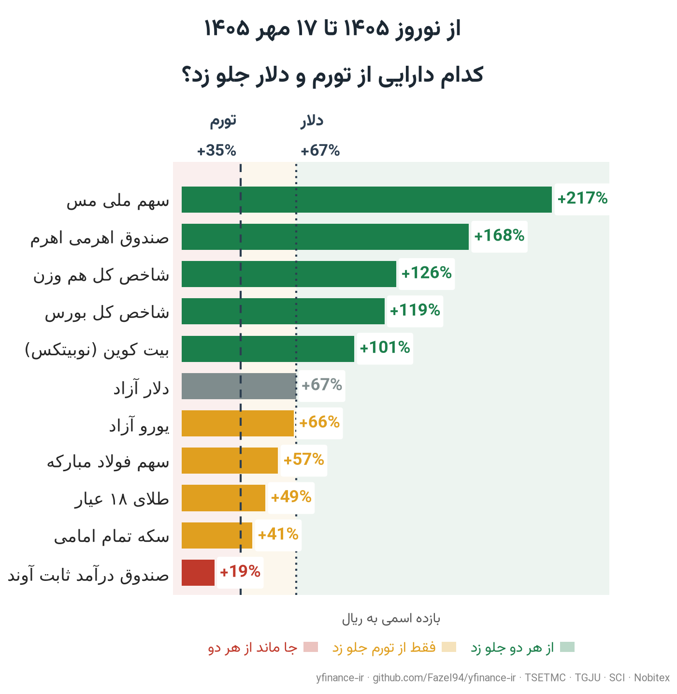

<div dir="rtl">

# yfinance-ir

[English](README.md)

داده‌های بازار ایران با همان شکل `yfinance`: TSETMC (سهام، صندوق‌ها، شاخص‌ها، اختیار معامله)، کدال
(صورت‌های مالی)، TGJU (ارز، طلا، سکه)، مرکز آمار (شاخص قیمت مصرف‌کننده)، و با افزونهٔ `crypto`
صرافی‌های رمزارز ایرانی.

> **به IP ایران نیاز دارد.** `cdn.tsetmc.com` به IP خارجی پاسخ نمی‌دهد.

[](examples/scoreboard.ipynb)

## نصب

<div dir="ltr">

```bash
pip install "yfinance-ir @ git+https://github.com/Fazel94/yfinance-ir.git@v2026.9.2"          # TSETMC + Codal + TGJU + CPI
pip install "yfinance-ir[crypto] @ git+https://github.com/Fazel94/yfinance-ir.git@v2026.9.2"  # adds BTC-IRT / ETH-USDT style pairs
```

</div>

روی PyPI نیست؛ از تگ انتشار نصب کنید. هر [GitHub Release](https://github.com/Fazel94/yfinance-ir/releases) فایل wheel و sdist را هم دارد.

## شروع سریع

<div dir="ltr">

```python
import yfinance_ir as yf

folad = yf.Ticker("فولاد")
folad.history(period="1y")          # adjusted daily OHLCV
folad.history(period="5d", interval="5m")   # intraday bars rebuilt from TSETMC trades
folad.info["marketCap"]
folad.income_stmt                   # Codal, wide, newest period first
folad.cashflow                      # Codal cash-flow statement
yf.Ticker("اهرم").option_chain()    # nearest expiration: calls, puts, underlying

yf.download(["فولاد", "فملی"], period="6mo")
yf.Ticker("USD").history(period="5y")   # TGJU dollar, Rial
yf.Ticker("شاخص کل").history()          # TEDPIX
yf.Ticker("CPI").history()              # SCI consumer price index, monthly
yf.Ticker("BTC-IRT").history()          # Nobitex, needs the `crypto` extra
```

</div>

فولاد در پنج سال اخیر به ریال ۲۲۸٪ رشد کرده، به دلار ۶۱٪ و به قیمت ثابت ۵۲٪ افت
([`examples/real_returns.py`](examples/real_returns.py)، خروجی ۲۰۲۶-۰۹-۲۱):

<div dir="ltr">

```
فولاد 2021-09-25 -> 2026-09-21 (5.0y)
        total annualised
Rial  +228.1%     +26.9%
USD    -60.8%     -17.1%
Real   -52.0%     -13.7%
```

</div>

## نمادها

| چه می‌دهید | به چه چیزی نگاشت می‌شود | مثال |
|---|---|---|
| Persian symbol | TSETMC instrument | `Ticker("فولاد")`, `Ticker("اهرم")` |
| Persian index name | TSETMC index | `Ticker("شاخص کل")` |
| InsCode (10–20 digits) | TSETMC instrument | `Ticker("46348559193224090")` |
| TGJU alias or slug | FX / gold / coin | `Ticker("USD")`, `Ticker("geram18")` |
| `CPI`, `CPI_URBAN`, `CPI_RURAL` | SCI price index | `Ticker("CPI")` |
| `BASE-IRT` / `BASE-USDT` | crypto pair | `Ticker("BTC-IRT")` |
| ISIN | cache lookup only, see below | `Ticker("IRO1FOLD0009")` |

## مقایسه با بسته‌های دیگر

| | yfinance-ir | [pytse-client](https://github.com/Glyphack/pytse-client) | [finpy-tse](https://github.com/ARahimiQuant/finpy-tse) | [tehran-stocks](https://github.com/ghodsizadeh/tehran-stocks) |
|---|---|---|---|---|
| منابع | TSETMC, Codal, TGJU, SCI CPI, Nobitex (`crypto` extra) | TSETMC | TSETMC, free-market dollar | TSETMC |
| شکل API | yfinance: `Ticker(...).history()`, `download([...])` | `Ticker(...).history` frame, `download(symbols=...)` | `Get_*_History()` functions | SQLAlchemy models + CLI |
| قیمت تعدیل‌شده روزانه | dividends and capital increases | `adjust=True` | `adjust_price=True` | dividend and share tables, no adjusted series documented |
| کندل درون‌روزی | `1m`–`90m`, `1h`, rebuilt from trades | `30s`–`1h`, aggregated from trade details (`get_trade_details(..., timeframe=)`) | trade and order-book history, no bars | — |
| تابلو و حقیقی/حقوقی | yes | yes | yes | — |
| صورت‌های مالی کدال | income, balance sheet, cash flow, monthly activity | — | — | — |
| زنجیرهٔ اختیار معامله | yes | — | — | — |
| ارز/طلا/سکه | TGJU | — | USD only (`Get_USD_RIAL`) | — |
| تورم (CPI) | SCI, monthly | — | — | — |
| تاریخچهٔ شاخص | any TSETMC index by name | `FinancialIndex(...).history` | `Get_CWI_History`, `Get_EWI_History`, sector indices | — |
| تاریخ جلالی | input and output | `include_jdate=True` | `jalali_date=True` | output |
| مجوز | MIT | GPL-3.0 | BSD-3-Clause | MIT |
| آخرین کامیت | 2026-10 | 2025-03 | 2024-04 | 2023-10 |
| PyPI | not yet, install from a release tag | yes | yes | yes |

در ۲۰۲۶-۱۰-۱۱ با README هر بسته مقایسه شده است؛ «—» یعنی README آن بسته این مورد را مستند نکرده.
اگر خانه‌ای نادرست است، issue باز کنید.

## بروزرسانی ماهانه

نمودار بالا هر ماه بعد از انتشار شاخص قیمت مرکز آمار دوباره رسم و در X منتشر می‌شود:
[@_fazel94](https://x.com/_fazel94)

## مستندات

جدول کامل API در [README انگلیسی](README.md)، قواعد در [docs/conventions.md](docs/conventions.md) و
جزئیات منابع در [docs/data-sources.md](docs/data-sources.md).

> **وابسته نیست** به yfinance، Yahoo، TSETMC، کدال، TGJU یا مرکز آمار ایران. این بسته از endpointهای
> عمومی آن‌ها می‌خواند و شکل API بستهٔ `yfinance` را تقلید می‌کند. درستی داده‌ها تضمین نمی‌شود و
> توصیهٔ سرمایه‌گذاری نیست؛ رعایت شرایط استفادهٔ هر منبع بر عهدهٔ شماست.

</div>
